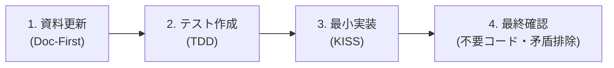

# AGENTS.md - 開発規約・エージェント行動規範

このドキュメントは、本プロジェクトに参画するすべてのAIエージェントおよび開発者が遵守すべき**最優先の行動規範**です。

---

## 1. 開発の基本理念（Core Philosophy）

1. **後方互換・レガシー移行の破棄**
   - 開発中プロジェクトにおいて古い仕様や過去データへの互換性は一切考慮しません。
   - 常に「現在における最も理想的で洗練されたコード」へ躊躇なく書き換えてください。
2. **KISS原則（Keep It Simple, Stupid）の徹底**
   - 不要な抽象化、過剰なフレームワーク、不要なComposerライブラリの追加を固く禁じます。
   - PHP標準機能（Standard Library）と素直な手続き・関数設計で、誰が見ても3秒で意図が伝わる最小限のコードを保ちます。
3. **資料ファースト（Doc-First）開発**
   - コードを書く前に、必ず関連ドキュメント（`docs/`）を更新してください。
   - 資料とコードの矛盾はバグとみなします。

---

## 2. 開発サイクル（4ステップ）

どのような改修・機能追加であっても、必ず以下のサイクルを1回転させて完了とします。



1. **資料を更新する**
   - `docs/` 配下の要件定義・仕様書を先に更新し、古い記述や矛盾を完全に排除します。
2. **テストを書く（TDD）**
   - 実装前にテストケース（`tests/run.php` など）を記述し、失敗（Red）を確認します。
3. **最小実装する**
   - テストを通過（Green）させる必要最小限のコードのみを記述します。
4. **不要コード・資料矛盾がないか最終確認する**
   - 未使用の変数・関数、デバッグログ、古いコメントを削除します。
   - 実装と資料（`docs/`、`README.md`）に1点の乖離もないことを再点検します。

---

## 3. 技術スタック・セキュリティ規約

- **PHP**: PHP 8.2以上（`declare(strict_types=1);` 必須）
- **文字コード**: UTF-8一貫（古いISO-2022-JPは廃止）
- **セキュリティの鉄則**:
  - **XSS対策**: 入力時ではなく、HTMLレンダリング時に `h()`（`htmlspecialchars`）を適用。
  - **メールヘッダ・インジェクション対策**: ヘッダ要素（件名、送信元、宛先）から `\r`, `\n`, `\0` を厳格に除去・拒絶。
  - **CSRF対策**: `random_bytes(32)` で生成し、`hash_equals()` による定数時間比較で照合。
  - **DMARC / SPF適合**: `From:` には常にシステムドメインを指定し、ユーザー宛て返信は `Reply-To:` で受ける。
  - **直接実行遮断**: 全ファイル先頭で `APP_RUN` 定数の存在を検査（Web直接アクセス拒絶）。

---

## 4. ディレクトリ構成

```text
project/
├── AGENTS.md                # 本ファイル（開発規約・エージェント規範）
├── README.md                # プロジェクト概要・図解・起動・テスト手順
├── docs/                    # 単一の信頼できる情報源（Single Source of Truth）
│   ├── requirements.md      # 要件定義（機能・非機能・入力制約）
│   ├── data-model.md        # データモデル・ライフサイクル設計
│   ├── api-specification.md # ルーティング・画面遷移仕様
│   └── prompt.md            # 完全再現用エージェントプロンプト
├── tests/                   # テスト自動化スイート
│   └── run.php              # 単体・セキュリティテストランナー
└── inquiry/                 # アプリケーション本体
    ├── .htaccess            # Apacheアクセス制御・リライト
    ├── config.php           # 設定・ヘルパー関数・バリデーション
    ├── index.php            # コントローラー・ルーティング
    ├── assets/              # 静的アセット（CSS / JS）
    └── templates/           # 画面HTMLテンプレート
```
