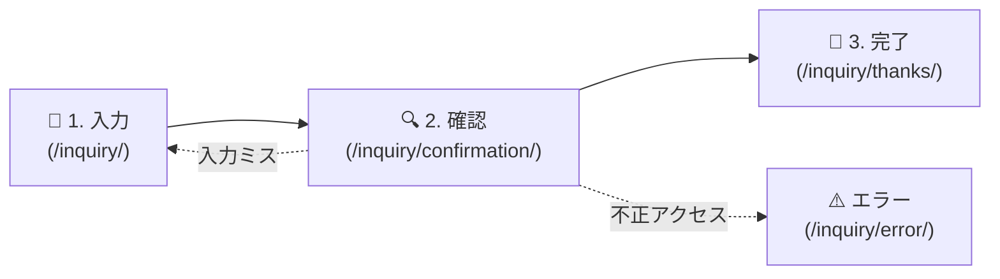

# ✉️ php-mail-form

> **モダン・セキュア・KISS原則（Keep It Simple, Stupid）** を極めた、外部ライブラリ依存ゼロのPHPメールフォーム。

---

## ⚡ 30秒でわかる全体図



---

## 🛡️ セキュリティ対策状況（100% 準拠）

| 脅威 / リスク | 当プロジェクトの対策 | 状態 |
| :--- | :--- | :---: |
| **メールヘッダ・インジェクション** | 件名・送信元・宛先から `\r`, `\n`, `\0` を完全除去 | ✅ 対策済 |
| **XSS（クロスサイトスクリプティング）** | 出力時エスケープ `h()` 徹底（メール本文はプレーンテキスト維持） | ✅ 対策済 |
| **CSRF（クロスサイトリクエストフォージェリ）** | 暗号学的乱数トークン + `hash_equals()` 定数時間比較 | ✅ 対策済 |
| **DMARC / SPF スパム判定** | `From:` を自社ドメイン固定、返信先は `Reply-To:` へ設定 | ✅ 対策済 |
| **直接ファイル実行・ソース漏洩** | `APP_RUN` 定数チェック + `.htaccess` のアクセス拒絶 | ✅ 対策済 |
| **PHP 8.2+ 互換性** | `declare(strict_types=1);`、未定義変数・NULL警告ゼロ | ✅ 対策済 |

---

## 🚀 すぐに動かす（Quick Start）

外部ツールや Composer のインストールは一切不要です。PHP があれば1行で起動します。

```bash
# 1. 組み込みWebサーバーで起動
php -S localhost:8000 -t .

# 2. ブラウザでアクセス
open http://localhost:8000/inquiry/
```

---

## 🧪 テストを実行する（TDD）

PHP標準環境のみで実行できる自動テストスイートが付属しています。

```bash
php tests/run.php
```

**実行結果例:**
```text
[PASS] h() escapes HTML special characters
[PASS] clean_header() strips carriage return and line feed
[PASS] clean_input() removes null bytes and normalizes CRLF
[PASS] CSRF token is 64-char hex string
[PASS] validate_csrf_token validates genuine token
[PASS] validate_csrf_token rejects forged token
[PASS] validate_form_data passes valid data
[PASS] validate_form_data rejects email with CRLF
...
--- Completed with 0 failure(s) ---
```

---

## 📁 ディレクトリ構成

```text
project/
├── AGENTS.md              # 開発規約・エージェント規範・KISS原則の徹底
├── README.md              # 本ファイル（概要・図解・起動・テスト手順）
├── docs/                  # 設計・仕様ドキュメント（単一の信頼できる情報源）
│   ├── requirements.md    # 要件定義（入力項目・バリデーション一覧）
│   ├── data-model.md      # データモデル・ライフサイクル設計
│   ├── api-specification.md # API仕様・ルーティング・画面遷移
│   └── prompt.md          # どのAIに渡しても同じコードになる指示プロンプト
├── tests/
│   └── run.php            # TDDテストスクリプト
└── inquiry/               # アプリケーションソースコード
    ├── index.php          # ルーティング・セキュリティヘッダ
    ├── config.php         # 設定・各種ヘルパー・メール送信処理
    ├── .htaccess          # ディレクトリ保護・URLリライト
    ├── assets/            # CSS / JS
    └── templates/         # 各画面テンプレート
```

---

## 📖 仕様書一覧

- 詳しい仕様を確認したい場合は [docs/requirements.md](docs/requirements.md) をご覧ください。
- ルーティング仕様は [docs/api-specification.md](docs/api-specification.md) をご覧ください。
- データ構造とライフサイクルは [docs/data-model.md](docs/data-model.md) をご覧ください。
- AIエージェントに同一コードを生成させたい場合は [docs/prompt.md](docs/prompt.md) をお使いください。
