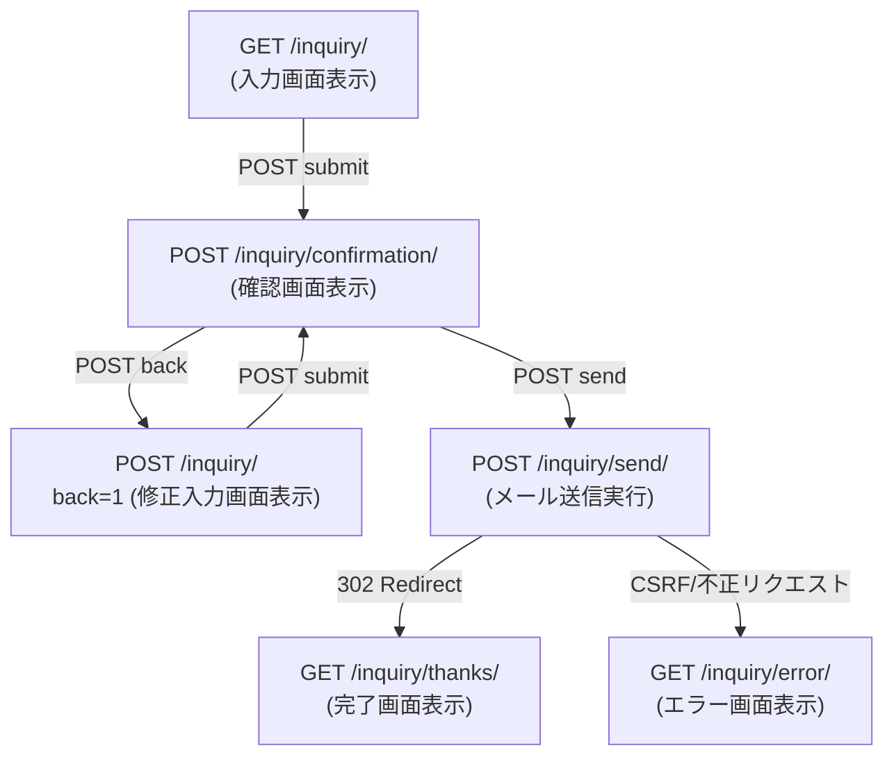

# API・画面遷移仕様書（Endpoint & Routing Specification）

本プロジェクトは `.htaccess` のリライトルールによって `index.php?q={route}` にルーティングされるシンプルなMVC/PageController構成です。

---

## 1. エンドポイント一覧マップ



---

## 2. エンドポイント詳細仕様

### 1. `GET /inquiry/`
- **目的**: 問い合わせ入力画面の表示
- **HTTPメソッド**: `GET`
- **処理**:
  - セッション開始（未開始時）
  - CSRFトークンが存在しなければ発行して埋め込む
  - 入力フォームを表示
- **レスポンス**: HTML（ステータス `200 OK`）

---

### 2. `POST /inquiry/confirmation/`
- **目的**: 入力内容の検証および確認画面の表示
- **HTTPメソッド**: `POST`（`GET` でアクセスされた場合は `/inquiry/` へ302リダイレクト）
- **リクエストパラメータ**:
  - `token` (string, 必須): CSRFトークン
  - `subject` (string, 必須): 件名
  - `name` (string, 必須): お名前
  - `email` (string, 必須): メールアドレス
  - `postal_code` (string, 任意): 郵便番号
  - `address` (string, 任意): 住所
  - `phone` (string, 任意): 電話番号
  - `content` (string, 必須): 質問等
- **処理**:
  1. CSRFトークンを検証。不正な場合は `/inquiry/error/` へリダイレクト。
  2. バリデーションを実行。エラーがあれば入力画面（エラーメッセージ付き）を再描画。
  3. 検証成功時、確認画面を表示。すべての出力は `h()` で安全にエスケープ。
- **レスポンス**: HTML（ステータス `200 OK`）

---

### 3. `POST /inquiry/`（戻るアクション）
- **目的**: 確認画面から入力内容を保持したまま入力画面へ戻る
- **HTTPメソッド**: `POST`
- **リクエストパラメータ**:
  - `back=1`: 戻るボタン識別子
  - 各入力値（hiddenで渡される）
- **処理**:
  - バリデーションはスキップし、渡された値を各フォーム要素の `value` に初期設定して入力画面を表示。
- **レスポンス**: HTML（ステータス `200 OK`）

---

### 4. `POST /inquiry/send/`
- **目的**: 問い合わせメールの送信処理実行
- **HTTPメソッド**: `POST`（`GET` アクセスは `/inquiry/` へリダイレクト）
- **リクエストパラメータ**:
  - `token` (string, 必須): CSRFトークン
  - 各入力データ
- **処理**:
  1. CSRFトークンを照合（不正時は `/inquiry/error/` へリダイレクト）。
  2. 入力データの再検証（改ざん対策）。
  3. メールヘッダ・本文を組み立て、管理者宛およびユーザー宛に送信。
  4. CSRFトークンを消去し、セッションIDを再生成（二重送信・セッション固定防止）。
  5. `/inquiry/thanks/` へ302リダイレクト（PRGパターン）。
- **レスポンス**: `302 Found` (`Location: /inquiry/thanks/`)

---

### 5. `GET /inquiry/thanks/`
- **目的**: 送信完了画面の表示
- **HTTPメソッド**: `GET`
- **処理**: 御礼メッセージを表示し、残存トークンがあれば確実に破棄。
- **レスポンス**: HTML（ステータス `200 OK`）

---

### 6. `GET /inquiry/error/`
- **目的**: 不正アクセス・有効期限切れエラー画面の表示
- **HTTPメソッド**: `GET`
- **処理**: エラーメッセージおよび最初からやり直す導線リンクを表示。
- **レスポンス**: HTML（ステータス `200 OK`）

---

## 3. 共通セキュリティヘッダ仕様

すべてのレスポンスで以下のヘッダを付与します。

```http
Content-Type: text/html; charset=UTF-8
X-Content-Type-Options: nosniff
X-Frame-Options: SAMEORIGIN
Referrer-Policy: strict-origin-when-cross-origin
Cache-Control: private, no-cache, no-store, must-revalidate
```

