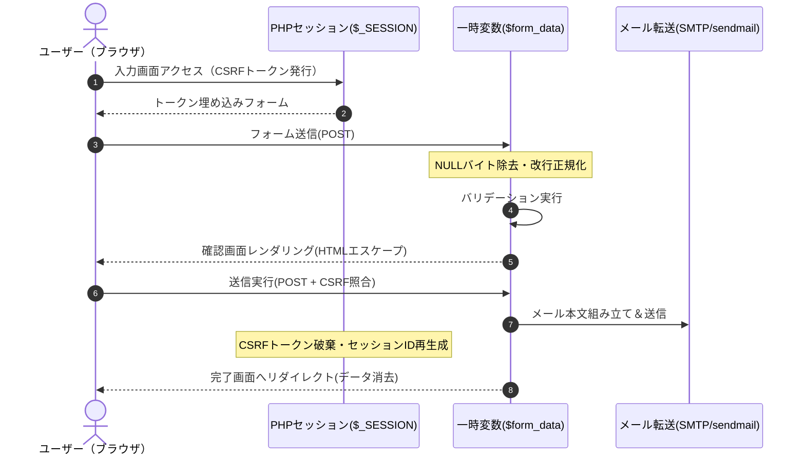

# データモデル・データ設計（Data Model Specification）

本プロジェクトは**データベース（RDBMS）を持たないステートレス／セッション一時保持型**のメールフォームです。  
送受信されるデータ項目とライフサイクルを明確に定義します。

---

## 1. データライフサイクル図

---

## 2. フォームデータモデル（FormData Schema）

入力から送信まで扱われるデータ構造です。

| フィールド名 | 型 | 必須 | 最大長 | 扱い（サニタイズ・エスケープ） |
| :--- | :--- | :---: | :--- | :--- |
| `subject` | `string` | ✅ | 20文字 | ホワイトリスト完全一致判定（`お問い合わせ` / `資料請求`） |
| `name` | `string` | ✅ | 100文字 | NULLバイト除去・前後空白除去。HTML出力時 `h()` |
| `email` | `string` | ✅ | 254文字 | `FILTER_VALIDATE_EMAIL` 検査。改行（`\r`,`\n`）禁止 |
| `postal_code` | `string` | 任意 | 8文字 | 半角数字・ハイフン形式正規化（例: `123-4567`） |
| `address` | `string` | 任意 | 500文字 | NULLバイト除去・前後空白除去。HTML出力時 `h()` |
| `phone` | `string` | 任意 | 20文字 | 半角数字・ハイフン形式正規化（例: `03-1234-5678`） |
| `content` | `string` | ✅ | 5000文字 | NULLバイト除去・改行コード正規化（`\n`）。HTML出力時 `nl2br(h())` |

---

## 3. セッションデータモデル（Session Schema）

| キー名 | 型 | 役割 | 有効期間 |
| :--- | :--- | :--- | :--- |
| `$_SESSION['csrf_token']` | `string` (64文字 hex) | CSRF攻撃防御用トークン | 入力画面表示で生成、送信完了時またはエラー時に即座に破棄 |

---

## 4. メールペイロードモデル（Mail Payload Schema）

### 管理者宛てメール (`build_admin_mail_body()`)
- **To**: `e@oshinco.com`
- **From**: `"お問い合わせ窓口" <no-reply@oshinco.com>`
- **Reply-To**: `"{name}" <{email}>`（改行・NULLバイト完全除去）
- **Subject**: `【メールフォーム】お客様よりお問い合わせがありました`
- **Body**: プレーンテキスト（UTF-8）。HTMLエスケープを行わない生のテキスト。

### ユーザー宛て控えメール (`build_user_mail_body()`)
- **To**: `{email}`
- **From**: `"お問い合わせ窓口" <no-reply@oshinco.com>`
- **Reply-To**: `no-reply@oshinco.com`
- **Subject**: `【メールフォーム】お問い合わせありがとうございました`
- **Body**: プレーンテキスト（UTF-8）。HTMLエスケープを行わない生のテキスト。

