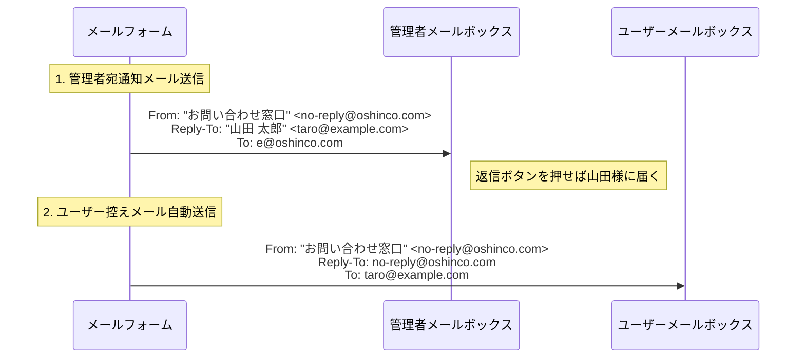

# 要件定義書（Requirements Specification）

本ドキュメントは、シンプルでセキュアなPHPメールフォームの仕様書です。  
**図解と表で1目見てすぐわかる構成**にしています。

---

## 1. 全体フロー図（3ステップで完了）

```mermaid
flowchart TD
    A["👤 1. 入力画面 (/inquiry/)<br/>フォーム入力"] -->|確認へ進む| B{"バリデーション検査<br/>＆ CSRF照合"}
    B -->|❌ エラーあり| A
    B -->|✅ 正常| C["👀 2. 確認画面 (/inquiry/confirmation/)<br/>入力内容チェック"]
    C -->|戻る| A
    C -->|送信する| D{"再検証 ＆ CSRF照合"}
    D -->|❌ 不正アクセス| E["⚠️ エラー画面 (/inquiry/error/)"]
    D -->|✅ 正常| F["✉️ メール自動送信<br/>(管理者宛 & ユーザー控え)"]
    F -->|リダイレクト (PRG)| G["🎉 3. 完了画面 (/inquiry/thanks/)"]
```

---

## 2. 画面一覧・役割

| 画面名 | URL | 役割 |
| :--- | :--- | :--- |
| **入力画面** | `/inquiry/` | お客様が問い合わせ情報を入力する |
| **確認画面** | `/inquiry/confirmation/` | 入力した内容に誤りがないか確認する |
| **完了画面** | `/inquiry/thanks/` | 送信完了の御礼・ご案内を表示する |
| **エラー画面** | `/inquiry/error/` | セッション切れ・不正アクセスの案内を表示する |

---

## 3. 入力項目とバリデーションルール一覧

| 項目名 | 必須 | 形式 / 制約 | エラーメッセージ | 具体例 |
| :--- | :---: | :--- | :--- | :--- |
| **件名** (`subject`) | ✅ 必須 | `お問い合わせ` または `資料請求` の選択肢限定 | `件名を選択してください。` | お問い合わせ |
| **お名前** (`name`) | ✅ 必須 | 文字列・100文字以内 | `お名前を入力してください。`<br/>`お名前は100文字以内で入力してください。` | 山田 太郎 |
| **メールアドレス** (`email`) | ✅ 必須 | RFC適合メールアドレス・254文字以内<br/>※改行コード（`\r`,`\n`）を含まないこと | `メールアドレスを入力してください。`<br/>`正しいメールアドレスを入力してください。` | `taro@example.com` |
| **郵便番号** (`postal_code`) | 任意 | 数字3桁-4桁（ハイフン有無両対応） | `郵便番号の形式が正しくありません。` | `100-0001` または `1000001` |
| **ご住所** (`address`) | 任意 | 文字列・500文字以内 | `ご住所は500文字以内で入力してください。` | 東京都千代田区千代田1-1 |
| **電話番号** (`phone`) | 任意 | 市外局番から始まる半角数字・ハイフン区切り形式 | `電話番号の形式が正しくありません。` | `03-1234-5678` |
| **質問等** (`content`) | ✅ 必須 | 文字列・5000文字以内 | `質問等を入力してください。`<br/>`質問等は5000文字以内で入力してください。` | サービス内容について質問です。 |

---

## 4. メール送信仕様（DMARC & インジェクション防御）

メール送信時は、現代のメール配信規約（Gmail/Yahoo等のDMARC要件）およびセキュリティ対策を100%満たします。



### 送信ルール詳細
1. **Fromアドレスの固定**: 常にサーバー自ドメインの `no-reply@oshinco.com` から送信（なりすまし判定を完全回避）。
2. **Reply-Toの活用**: 管理者通知の `Reply-To:` にユーザーのメールアドレスを指定（1クリックで返信可能）。
3. **改行除去（ヘッダインジェクション対策）**: 件名・送信者名・メールアドレスから `\r`, `\n`, `\0` を完全除去。
4. **UTF-8一貫処理**: 本文・件名ともにUTF-8で統一（絵文字や特殊漢字の文字化けを防止）。

---

## 5. セキュリティ非機能要件

- **XSS防御**: すべてのHTML出力箇所で `h()`（`htmlspecialchars($val, ENT_QUOTES | ENT_SUBSTITUTE, 'UTF-8')`）を適用。
- **CSRF防御**: 暗号論的擬似乱数 `random_bytes(32)` でトークンを発行し、`hash_equals()` で常時比較。送信完了時に破棄。
- **セッション防御**: `HttpOnly`, `SameSite=Lax`, HTTPS時の `Secure` 属性を強制。重要遷移時の `session_regenerate_id(true)`。
- **ファイル直アクセス遮断**: `.htaccess` および各スクリプト先頭の `APP_RUN` 定数チェックによる二重防御。
- **KISS原則**: 外部依存（Composerパッケージ等）ゼロ。PHP標準関数のみで最小実装。

